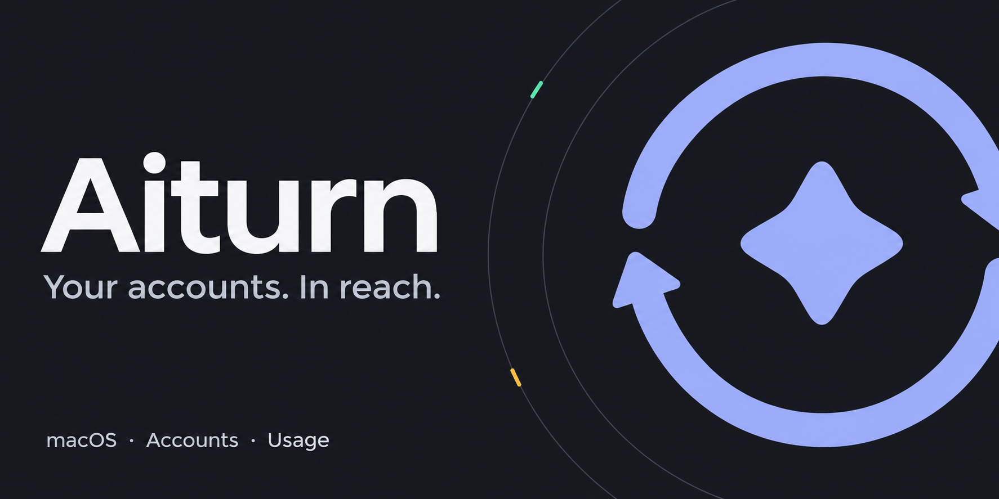

<p align="center"></p>

# Aiturn

AI coding accounts, workspaces and usage limits in your Mac’s menu bar.

[English](#english) · [فارسی](#فارسی) · [Download](https://github.com/amirmahdinezhad/aiturn/releases/latest)

## English

Aiturn brings your AI coding accounts into one native menu-bar panel. Organize
accounts into workspaces, check usage and reset times, and choose which account
to use without editing authentication files by hand.

- **Accounts:** save and switch Codex and Claude Code logins; experimental Antigravity support.
- **Usage:** provider-reported limits, reset countdowns and menu-bar indicators. Available fields depend on the provider and plan.
- **Workspaces:** group accounts and choose separate usage, switching and menu-bar preferences.
- **Appearance:** light, dark or system theme, with keyboard-accessible controls.
- **Updates:** read the notes, download, then explicitly choose **Install & relaunch**.

OpenCode and Gemini CLI connections are detected when available; their features
differ from saved-account providers. Quota views require a supported subscription login.

### Download & install

**macOS 12 or newer · Apple Silicon and Intel · no Node.js required**

[Download Aiturn 1.0.0](https://github.com/amirmahdinezhad/aiturn/releases/download/v1.0.0/Aiturn_1.0.0_universal.dmg)

1. Open the DMG and drag **Aiturn** into **Applications**.
2. Launch Aiturn and click its menu-bar icon.
3. Create a workspace and add or import your accounts.

This build is ad-hoc signed and **not Apple notarized**. If macOS blocks its first
launch, allow it in **System Settings → Privacy & Security → Open Anyway**.
Earlier development builds need a manual installation of this fresh 1.0.0 release; reimport saved accounts into the new profile store. Provider CLI logins remain intact.

### Privacy & updates

Account credentials stay in local files; protect them like passwords. Aiturn
connects to providers for sign-in and usage, and GitHub for releases. It has no
Aiturn cloud account. See [local storage](docs/DEVELOPMENT.md#local-data).

Use **Settings → Updates → Check for updates** to review and download a release.
Installation waits for **Install & relaunch**. To remove the app, quit Aiturn and
move it from Applications to Trash; saved local account data remains.

## فارسی

Aiturn حساب‌های ابزارهای کدنویسی هوش مصنوعی را در یک پنل داخل نوار منوی مک
جمع می‌کند. حساب‌ها را در فضاهای کاری مرتب کنید، مصرف و زمان بازنشانی محدودیت‌ها
را ببینید و بدون ویرایش دستی فایل‌های ورود، حساب فعال را عوض کنید.

- **حساب‌ها:** ذخیره و تعویض حساب‌های Codex و Claude Code؛ پشتیبانی آزمایشی Antigravity.
- **مصرف:** محدودیت‌های دریافتی از سرویس، شمارش معکوس بازنشانی و نمایش وضعیت در نوار منو.
- **فضای کاری:** گروه‌بندی حساب‌ها و تنظیم جداگانهٔ نمایش مصرف و رفتار تعویض حساب.
- **ظاهر:** تم روشن، تیره یا هماهنگ با سیستم و کنترل‌های قابل استفاده با صفحه‌کلید.
- **به‌روزرسانی:** مشاهدهٔ تغییرات، دانلود و نصب با انتخاب جداگانهٔ شما.

اتصال OpenCode و Gemini CLI هم در صورت موجودبودن شناسایی می‌شود؛ امکانات
هر سرویس متفاوت است. نمایش سهمیه به نوع ورود و اشتراک پشتیبانی‌شده بستگی دارد.

### دانلود و نصب

**macOS 12 یا جدیدتر · مک‌های Apple Silicon و Intel · بدون نیاز به Node.js**

[دانلود Aiturn 1.0.0](https://github.com/amirmahdinezhad/aiturn/releases/download/v1.0.0/Aiturn_1.0.0_universal.dmg)

۱. فایل DMG را باز کنید و Aiturn را به Applications بکشید.
۲. برنامه را اجرا کنید و روی آیکون آن در نوار منو بزنید.
۳. فضای کاری بسازید و حساب‌هایتان را اضافه یا وارد کنید.

این نسخه امضای محلی دارد و Apple آن را notarize نکرده است. اگر اولین اجرا مسدود
شد، از **System Settings → Privacy & Security → Open Anyway** اجازهٔ اجرا بدهید.
برای گذر از نسخه‌های آزمایشی قبلی، نسخهٔ 1.0.0 را دستی نصب و حساب‌های ذخیره‌شده را دوباره وارد کنید. ورود ابزارهای خط فرمان باقی می‌ماند.

### داده‌ها و به‌روزرسانی

اطلاعات ورود در فایل‌های محلی مک ذخیره می‌شوند؛ از آن‌ها مثل رمز عبور مراقبت کنید.
برنامه برای ورود و مصرف به سرویس‌ها و برای دریافت نسخهٔ جدید به گیت‌هاب وصل می‌شود.
[جزئیات ذخیره‌سازی](docs/DEVELOPMENT.md#local-data).

در **Settings → Updates** تغییرات را بخوانید و **Download** را بزنید؛ نصب فقط
با **Install & relaunch** انجام می‌شود. برای حذف، ابتدا از برنامه خارج شوید و آن
را از Applications به Trash ببرید. داده‌های محلی حساب‌ها باقی می‌مانند.

## Development

Requires pnpm, Rust and the macOS Tauri build tools.

```sh
git clone https://github.com/amirmahdinezhad/aiturn.git
cd aiturn
pnpm install --frozen-lockfile
pnpm run run
```

Development uses port **5174**; the real app is the native tray panel.
[Development](docs/DEVELOPMENT.md) · [Testing](docs/TESTING.md) ·
[Architecture](CONTRACT.md) · [Releasing](docs/RELEASING.md) · [Security](docs/SECURITY.md)
